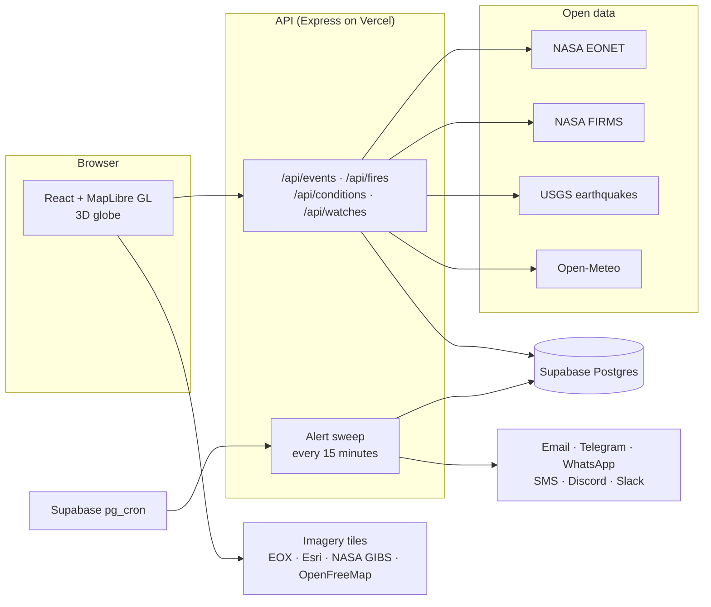

<div align="center">

# Vigil

**A live watch over Earth.**

A 3D globe of what the planet is doing right now, built on NASA open data,<br>
with alerts for the places you care about.

<a href="https://earth-vigil.vercel.app"><b>Open the live site</b></a>
&nbsp;&nbsp;·&nbsp;&nbsp;
<a href="#run-it-yourself">Run it yourself</a>
&nbsp;&nbsp;·&nbsp;&nbsp;
<a href="DEPLOY.md">Deploy your own</a>

<br>


</div>

<br>

## What is Vigil?

Vigil puts the planet's live natural events on a single globe: wildfires burning right now, storms and their tracks, volcanoes, floods, icebergs, earthquakes and severe weather. You can search for any place, see what is happening around it, and ask to be told the moment something new appears there. Alerts can go by email, Telegram, WhatsApp, SMS, Discord or Slack.

Everything comes from open, public data, mostly from NASA. Vigil needs no API keys to run, and a full deployment fits within free hosting tiers.

<br>

## What it does

<table>
<tr>
<td width="33%" valign="top">

### See the planet

- A 3D globe with cloud-free Sentinel-2 imagery that sharpens to Esri satellite detail up close
- Real terrain, with Google Earth-style tilted fly-ins
- Every satellite fire detection from the last 24 hours
- Open natural events from NASA EONET, with storm tracks
- NASA GIBS overlays: today's satellite pass, clouds, rain, smoke, city lights
- A 30-day imagery timeline you can scrub or play

</td>
<td width="33%" valign="top">

### Inspect any place

Search for a city, region or coordinates, or click anywhere on the globe. Vigil frames the place and reports what is within 25 to 500 km:

- Natural events and fire hotspots
- Earthquakes in the last 30 days
- Current weather and a 3-day forecast
- Air quality
- Plain-language warnings for heat, cold, heavy rain, wind, storms and bad air

</td>
<td width="33%" valign="top">

### Get alerted

Choose what to watch for and where to send it:

- **Live hazards:** fire hotspots, earthquakes above a magnitude you pick, weather and air warnings
- **NASA events:** wildfires, storms, volcanoes, floods, landslides, ice and more
- **Channels:** email, Telegram, WhatsApp, SMS, Discord or Slack

You only hear about *new* signals. Every message has a one-click stop link.

</td>
</tr>
</table>

<br>

## How it works



**The globe.** The browser renders the planet with MapLibre GL in globe projection. Imagery tiles load straight from their providers. Event, fire and weather data comes through Vigil's API, which caches it at the CDN edge. NASA sees roughly the same handful of requests an hour whether ten people or ten thousand are watching.

**The alerts.** Each watch is a place, a radius and a list of things to watch for, stored in Postgres. Every 15 minutes a scheduled sweep fetches the latest feeds once and checks every watch against them. The sweep remembers what each watch has already been told, so a message only goes out when something is new. Forecast-based warnings are checked every 6 hours per place. When none of the feeds have changed, the sweep skips the database entirely, which keeps it cheap on free plans.

### Data sources

| Source | What Vigil uses it for | Key needed |
|---|---|---|
| [NASA EONET](https://eonet.gsfc.nasa.gov/) | Open natural events: storms, wildfires, volcanoes, ice, floods | No |
| [NASA FIRMS](https://firms.modaps.eosdis.nasa.gov/) | Satellite fire detections from the last 24 hours (VIIRS, MODIS) | No (optional) |
| [NASA GIBS](https://www.earthdata.nasa.gov/engage/open-data-services-software/earthdata-developer-portal/gibs-api) | Daily satellite pass, clouds, rain, aerosols, city lights | No |
| [USGS](https://earthquake.usgs.gov/earthquakes/feed/) | Earthquakes, magnitude 2.5 and above | No |
| [Open-Meteo](https://open-meteo.com/) | Weather, 3-day forecast and air quality | No |
| [Sentinel-2 cloudless by EOX](https://s2maps.eu) | The base imagery of the globe | No |
| [Esri World Imagery](https://www.arcgis.com/home/item.html?id=10df2279f9684e4a9f6a7f08febac2a9) | High-resolution close-up imagery | No |
| [AWS Terrain Tiles](https://registry.opendata.aws/terrain-tiles/) | 3D terrain | No |
| [OpenFreeMap](https://openfreemap.org/) / OpenStreetMap | Borders, roads and place names | No |
| [Photon](https://photon.komoot.io/) | Place search | No |

<br>

## Run it yourself

### Requirements

- [Node.js](https://nodejs.org/) 22 or newer
- Git

### Start it locally

```bash
git clone https://github.com/0-two/Planetwatch.git
cd Planetwatch
npm install
npm run dev
```

Open **http://localhost:5173**. The API runs alongside it on port 8787.

You don't need any keys or accounts to try it. Locally, watches are saved to `data/watches.json`. Any alert channel without credentials runs in **dry-run** mode: the exact message is printed in the terminal instead of being sent, so you can try the whole alert flow first.

### Turn on real alerts

Copy the example settings and fill in only the channels you want:

```bash
cp .env.example .env
```

| Channel | Settings | Where to get them |
|---|---|---|
| Email | `SMTP_HOST`, `SMTP_PORT`, `SMTP_USER`, `SMTP_PASS`, `MAIL_FROM` | Any SMTP provider: Brevo, Resend, Postmark, Amazon SES, or a Gmail app password |
| Telegram | `TELEGRAM_BOT_TOKEN`, `TELEGRAM_BOT_USERNAME` | Message **@BotFather** on Telegram and send `/newbot` |
| SMS | `TWILIO_ACCOUNT_SID`, `TWILIO_AUTH_TOKEN`, `TWILIO_SMS_FROM` | The Twilio console, with an SMS-capable number |
| WhatsApp | The Twilio settings above plus `TWILIO_WHATSAPP_FROM` | The Twilio WhatsApp sandbox to start; production needs an approved sender |
| Discord, Slack | Nothing | Each person pastes their own incoming-webhook URL |
| Fires (optional) | `FIRMS_MAP_KEY` | [FIRMS map key](https://firms.modaps.eosdis.nasa.gov/api/map_key/); without it Vigil uses the public 24-hour files |

Restart `npm run dev` after editing `.env`.

### Useful commands

| Command | What it does |
|---|---|
| `npm run dev` | Website and API with live reload |
| `npm run build` | Type-check and build the website into `dist/` |
| `npm start` | Build, then serve the website and API from one process |
| `npm run typecheck` | Type-check the website and the server |
| `npm run telegram:webhook -- <url>` | Point your Telegram bot at a deployed site |

<br>

## Put it online

**Free hosting (recommended):** Vercel hosts the site and API, and Supabase provides the database and the 15-minute scheduler. It takes about 20 minutes and costs nothing. Follow **[DEPLOY.md](DEPLOY.md)** step by step. It also lists the free-tier limits and how far they stretch.

**Your own server:** any machine with Docker will do, for example an Oracle Cloud Always Free VM.

```bash
docker build -t vigil .
docker run -p 8787:8787 --env-file .env -v vigil-data:/app/data vigil
```

One process serves the site and the API and runs its own 15-minute timer. It uses Supabase if configured, and a JSON file otherwise.

<br>

## Project structure

```
src/                      the website (React + TypeScript)
├─ components/Globe.tsx    globe, imagery, terrain, labels and every map layer
├─ components/             ledger, search, place report, alert form, layers, timeline, intro
└─ lib/                    API client, imagery catalogue, geometry helpers

server/                   the API (Express + TypeScript)
├─ app.ts                  every HTTP route, shared by Vercel and the self-hosted server
├─ data/                   EONET, FIRMS, USGS and Open-Meteo clients with caching
├─ alerts/engine.ts        matching, de-duplication and the 15-minute sweep
├─ alerts/channels.ts      email, Telegram, SMS, WhatsApp, Discord and Slack delivery
└─ store.ts                Supabase Postgres, or a JSON file locally

api/index.ts              the Vercel serverless entry point
supabase/                 database tables (schema.sql) and the scheduler (cron.sql)
```

**Built with:** React 19, Vite, TypeScript, MapLibre GL, Motion, Express and Supabase.
**Typefaces:** Newsreader, Schibsted Grotesk and Fragment Mono, self-hosted through Fontsource.

<br>

## Good to know

- **Not an emergency service.** Satellite and sensor feeds can lag reality by hours. In an emergency, always follow your local authorities.
- **Non-commercial data.** Several sources, including the Sentinel-2 cloudless imagery and Open-Meteo's free API, are free for non-commercial use only. Check their terms before using Vigil commercially.
- **Credits.** Imagery: Sentinel-2 cloudless by EOX IT Services (contains modified Copernicus Sentinel data), Esri, Maxar and Earthstar Geographics, and NASA GIBS. Map data © OpenStreetMap contributors.

<br>

<div align="center">
<sub>Made with open data from NASA, USGS, Copernicus and OpenStreetMap.</sub>
</div>
